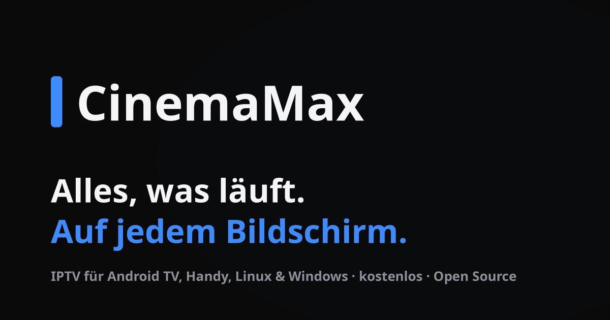
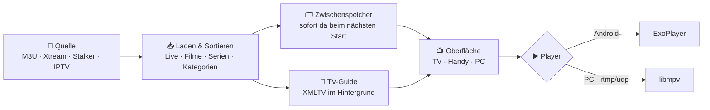

<div align="center">


# CinemaMax

**Alles, was läuft. Auf jedem Bildschirm.**

Kostenloser, quelloffener IPTV-Player für **Android TV, Handy, Linux und Windows**.<br>
M3U, Xtream Codes, Stalker und freie IPTV-Sender in einer App. Ohne Werbung, ohne Tracking.

[](https://github.com/Emre1001/CinemaMax/releases/latest)
[](https://github.com/Emre1001/CinemaMax/releases)
[](LICENSE)
[](https://github.com/Emre1001/CinemaMax/actions)


### [🌐 Website & Live-Vorschau](https://emre1001.github.io/CinemaMax/) · [⬇️ Download](#-download) · [✨ Funktionen](#-funktionen) · [❓ FAQ](#-faq)

<a href="https://emre1001.github.io/CinemaMax/"></a>

</div>

> [!TIP]
> Auf der **[Website](https://emre1001.github.io/CinemaMax/)** kannst du die App direkt im Browser ausprobieren: als Fernseher, Handy oder PC, mit Maus oder Pfeiltasten.

---

## 🛠️ Neu in 1.7.2

- **Schlichteres Aussehen**: keine bewegten Farbwolken, Lichtpunkte, Glanzstreifen und Verläufe mehr. Die Leistungsmodi unterscheiden sich nur noch in den Animationen
- **Handy**: nichts liegt mehr unter Kamera-Loch, Statusleiste oder Gestenleiste, auch im Querformat; Zurück-Geste mit Vorschau (Android 13+)
- **An Fernseher senden** (Webseite): die Anzeige springt nicht mehr auf „Keine Antwort“, wenn der Fernseher sehr schnell antwortet; Felder bleiben bei offener Tastatur sichtbar
- **Windows**: das heruntergeladene Update-Setup wird beim nächsten Start gelöscht

## 🛠️ Fehlerfixes in 1.7.1

- **Logos und Poster** laden wieder zuverlässiger: bei Fehlern zwei neue Versuche, der letzte ohne Player-Kennung (manche Bild-Server sperren sie)
- **Weniger Speicher**: die heruntergeladene Update-APK wird nach dem Update gelöscht
- **Weiterschauen**: eine Serie erscheint nur einmal, mit der zuletzt gesehenen Folge, statt jeder Folge einzeln

## 🆕 Neu in 1.7.0

- **Einrichtung beim ersten Start**: Sprache, Aussehen, Leistung, Bildschirm und ein **Geräte-Check**, der zeigt, welche Formate dein Gerät abspielt (H.265, AV1, Dolby Digital, DTS, 4K, HDR)
- **Hell, dunkel oder wie das Gerät**, mit neuem Design und flüssigen Übergängen
- **Leistungsmodus**: Alle Effekte, Flüssig (TV-Boxen, alte Handys) oder Speed ohne Animationen; die App erkennt schwache Geräte selbst
- **Bildschirmauflösung**: Streams nie größer als der Bildschirm zeigt (144p bis 4K), spart Daten und Leistung
- **Mehr abspielbar**: Dolby Digital, DTS und TrueHD ohne Decoder im Gerät, Streams von Servern mit abgelaufenem https-Zertifikat, weitere externe Player (mpv, Just Player, Kodi)
- **Fernbedienung** an vielen Stellen verbessert, weniger Ruckeln bei Live-Sendern (mpv)

---

## ⬇️ Download

| Gerät | Datei | Hinweis |
|---|---|---|
| 📱 **Android & Android TV** | [`CinemaMax-*.apk`](https://github.com/Emre1001/CinemaMax/releases/latest) | Eine APK für beide. Ab Android 7. |
| 🪟 **Windows 10 / 11** | [`CinemaMax-*-windows-setup.exe`](https://github.com/Emre1001/CinemaMax/releases/latest) | Installer starten, fertig. Ohne Admin-Rechte möglich. |
| 🐧 **Linux (jedes)** | [`CinemaMax-*-x86_64.AppImage`](https://github.com/Emre1001/CinemaMax/releases/latest) | Ausführbar machen, starten. libmpv ist dabei. |
| 🐧 **Ubuntu, Mint, Debian** | [`cinemamax_*_amd64.deb`](https://github.com/Emre1001/CinemaMax/releases/latest) | `sudo apt install ./cinemamax_*_amd64.deb` (libmpv1 oder libmpv2) |
| 🐧 **Fedora, openSUSE** | [`cinemamax-*.x86_64.rpm`](https://github.com/Emre1001/CinemaMax/releases/latest) | `sudo dnf install ./cinemamax-*.rpm` |

<details>
<summary><b>📺 So kommt die App auf den Fernseher</b></summary>

1. Auf dem Fernseher die App **Downloader** (oder einen Dateimanager) aus dem Play Store installieren.
2. In den Einstellungen **Apps aus unbekannten Quellen** für diese App erlauben.
3. Die APK aus den [Releases](https://github.com/Emre1001/CinemaMax/releases/latest) herunterladen und installieren.
4. CinemaMax erscheint mit eigenem Banner im Startbildschirm.

</details>

<details>
<summary><b>🪟 Windows meldet „Der Computer wurde geschützt“</b></summary>

Die App ist nicht signiert. Auf **Weitere Informationen** klicken, dann **Trotzdem ausführen**.

</details>

---

## ✨ Funktionen

<table>
<tr>
<td width="50%" valign="top">

### 📡 Alle Quellen
- **Freie IPTV-Sender** aus über 20 Ländern ([iptv-org](https://github.com/iptv-org/iptv)), ohne Anmeldung
- **Eigene IPTV-Listen** (beliebige M3U-Links)
- **M3U / M3U8** mit `tvg-logo`, `group-title`, `#EXTVLCOPT`, `#EXTHTTP` und Kodi-Headern (`url|User-Agent=…`)
- **Xtream Codes**: Live, Filme, Serien, Kontoinfo (Ablaufdatum, Verbindungen)
- **Stalker / MAG-Portale** mit MAC-Adresse
- Mehrere Server nebeneinander

</td>
<td width="50%" valign="top">

### 📺 Fernsehen
- **Live TV** mit Kategorien und Länder-Filter (`DE |`, `|TR|` …)
- **TV-Guide** (XMLTV, auch `.gz`) und „Jetzt läuft“ auf jeder Kachel
- **Rückschau** vergangener Sendungen (Xtream Catch-up)
- **Zappen** mit Hoch/Runter, Sendernummer per Zifferntasten
- **Live-Aufnahme** für 15 Minuten bis 3 Stunden
- Automatisch neu verbinden bei Abbrüchen

</td>
</tr>
<tr>
<td valign="top">

### 🎬 Filme & Serien
- Automatische Trennung von Live, Filmen und Serien, auch bei M3U
- Folgen werden zu **Staffeln** gruppiert
- **Weiterschauen** an der letzten Stelle, nächste Folge automatisch
- Startseite mit **Neu**, **Top bewertet**, Favoriten
- **Downloads** von Filmen, Folgen und ganzen Staffeln, fortsetzbar; bei HLS mit **wählbarer Auflösung** (spart Speicher, Größe wird vorher angezeigt)

</td>
<td valign="top">

### ▶️ Player
- **ExoPlayer** auf Android, für IPTV angepasst (Software-Decoder als Rückfall, lange Timeouts, TS ohne Keyframe-Start)
- **libmpv** auf Linux und Windows, auf Android wählbar
- **Externe Player**: VLC und mpv (Android, Linux, Windows), MX Player, Just Player und Kodi (Android), für alles oder einzeln über „Mehr“; Android merkt sich die Stelle zum Weiterschauen
- **FFmpeg-Tondecoder** in ExoPlayer: AC3, E-AC3, DTS und TrueHD auch auf Geräten ohne eigenen Decoder
- HLS, MPEG-TS, MP4, MKV, DASH, RTSP, RTMP, UDP, SRT (SRT/MMS auf Android über VLC)
- **Auflösung wählen** (Automatisch, 1080p, 720p …) bei HLS/DASH
- **Bildschirmauflösung**: Streams nie höher laden als der Bildschirm zeigt (automatisch erkannt, auch 4K-Fernseher), wählbar von 144p bis 4K; spart Daten und Leistung
- Scheitert ein Player, springt automatisch der andere ein (Android: ExoPlayer ↔ mpv)
- Fehler als verständlicher Text statt Absturz
- **Nächste Folge** mit Countdown im Abspann, **Intro überspringen** (10 s mit Countdown), „Schaust du noch?“
- Folgenliste mit Staffeln im Player, Ton & Untertitel in einem Fenster
- Bildformat (Einpassen, Original 1:1, Zoomen, Strecken, 16:9, 4:3), Tempo bis 3x, Sleep-Timer (auch „Ende dieser Folge“), Endzeit-Anzeige
- **Externe Links**: „Öffnen mit“/„Teilen“ auf Android, Dateien/Links am PC, „Link öffnen“ im Startbildschirm
- **Bild-in-Bild** auf dem Handy, Vollbild am PC

</td>
</tr>
<tr>
<td valign="top">

### 🕹️ Bedienung
- **Android TV**: alles mit der Fernbedienung, eigene TV-Oberfläche; Optionen über ⋮ oder OK gedrückt halten
- **Per Code empfangen**: Der Fernseher zeigt einen QR-Code und einen Code. Zugangsdaten (Xtream, M3U, Stalker) kommen per Handy-Kamera, aus der App eines Freundes oder über [die Webseite](https://emre1001.github.io/CinemaMax/tv/) von überall auf der Welt, Ende-zu-Ende verschlüsselt
- **Handy**: Touch, untere Leiste, Querformat im Player
- **PC**: Maus, Tastatur, feste Seitenleiste
- Die Oberfläche erkennt das Gerät selbst
- **Einrichtung** beim ersten Start: Sprache, Aussehen, Leistung, Bildschirm und **Geräte-Check** (welche Formate das Gerät abspielt)
- **Leistungsmodus**: Alle Effekte, Flüssig (TV-Boxen, alte Handys) oder Speed (ohne Animationen); automatisch nach Gerät und gemessener Bildrate

</td>
<td valign="top">

### ⚙️ Einstellungen (über 40)
- **Erscheinungsbild**: hell, dunkel oder wie das Gerät (wechselt mit dem System)
- **Akzentfarbe**: 10 Vorlagen oder eigene Farbe
- **Sprachen**: Deutsch, English, Türkçe (folgt dem System)
- **Kindersicherung** mit PIN, Kategorien ausblenden, App-PIN
- User-Agent, Puffer, Hardware-Dekodierung, Sicherung per Zwischenablage
- Startanimation mit eigenem Startton

</td>
</tr>
</table>

---

## 🧭 So funktioniert's



<details>
<summary><b>🔑 Xtream Codes eintragen</b></summary>

Start › **M3U / Xtream / Stalker** › **Server hinzufügen** › **Xtream Codes**

| Feld | Beispiel |
|---|---|
| Server-URL | `http://anbieter.example:8080` |
| Benutzername | `max` |
| Passwort | `••••••` |

Tipp: Ein Link wie `http://host/get.php?username=…&password=…` im Feld **M3U-Link** wird automatisch als Xtream-Zugang erkannt. Dann gibt es auch Filme, Serien, TV-Guide und Rückschau.

</details>

<details>
<summary><b>📄 M3U-Playlist eintragen</b></summary>

Start › **M3U / Xtream / Stalker** › **Server hinzufügen** › **M3U-Link**, dann die Adresse der Liste einfügen.

```m3u
#EXTM3U url-tvg="https://example.net/epg.xml.gz"
#EXTINF:-1 tvg-id="kanal.de" tvg-logo="https://example.net/logo.png" group-title="DE | Vollprogramm",Kanal HD
#EXTVLCOPT:http-user-agent=MeinPlayer/1.0
http://example.net/live/kanal.m3u8
```

Der TV-Guide wird aus `url-tvg` gelesen. Fehlt er, im Server-Menü (lange drücken) eine eigene **EPG-URL** eintragen.

</details>

<details>
<summary><b>📟 Stalker-Portal eintragen</b></summary>

Start › **M3U / Xtream / Stalker** › **Server hinzufügen** › **Stalker-Portal**

| Feld | Beispiel |
|---|---|
| Portal-URL | `http://portal.example:8080/c/` |
| MAC-Adresse | `00:1A:79:XX:XX:XX` |

Die MAC-Adresse muss beim Anbieter freigeschaltet sein. CinemaMax findet den Portal-Pfad (`portal.php`, `server/load.php`, `stalker_portal/…`) selbst.

</details>

---

## 🎮 Tasten

| Fernbedienung / Tastatur | Im Menü | Im Player |
|---|---|---|
| <kbd>↑</kbd> <kbd>↓</kbd> | bewegen | Sender wechseln (Live) |
| <kbd>←</kbd> <kbd>→</kbd> | Seitenleiste / Inhalt | Senderliste bzw. spulen |
| <kbd>OK</kbd> | öffnen | Bedienleiste zeigen, im Abspann nächste Folge, am Anfang Intro überspringen |
| <kbd>OK</kbd> lange / <kbd>Menü</kbd> | Favorit / Optionen | Senderliste |
| <kbd>0</kbd>–<kbd>9</kbd> | | Sendernummer eingeben |
| <kbd>Zurück</kbd> | zur Seitenleiste | Bedienleiste ausblenden, dann zurück |
| <kbd>Leertaste</kbd> · <kbd>F</kbd> · <kbd>M</kbd> | | Pause · Vollbild · Ton aus (PC) |
| <kbd>N</kbd> · <kbd>S</kbd> · <kbd>↑</kbd> <kbd>↓</kbd> | | Nächste Folge · Intro überspringen · Lautstärke (PC) |
| <kbd>J</kbd> <kbd>K</kbd> <kbd>L</kbd> · <kbd>0</kbd>–<kbd>9</kbd> · <kbd>[</kbd> <kbd>]</kbd> · Mausrad | | ±10 s / Pause · Sprung 0–90 % · Tempo · Lautstärke (PC) |
| <kbd>Info</kbd> · <kbd>Guide</kbd> · <kbd>Stop</kbd> | | Info · Sender-/Folgenliste · Beenden |
| 🔴 🟢 🟡 🔵 | | Favorit · Ton & Untertitel · Qualität · Mehr |
| <kbd>Strg</kbd> + <kbd>F</kbd> | Suche | |

---

## ❓ FAQ

<details>
<summary><b>Bringt CinemaMax Sender mit?</b></summary>

Nein. CinemaMax ist nur ein Player. Er spielt die freien, öffentlichen Listen von iptv-org und Quellen ab, die du selbst einträgst. **Nutze nur Quellen, zu deren Nutzung du berechtigt bist.**

</details>

<details>
<summary><b>Ein Sender bleibt schwarz.</b></summary>

1. Im Player auf **Info** schauen: Dort steht der Fehler, z. B. `HTTP 403`.
2. Der **Geräte-Check** (Einstellungen › Start) zeigt, ob dein Gerät das Format abspielen kann.
3. In den Einstellungen einen anderen **User-Agent** probieren (VLC, Kodi, Browser …).
4. **Player** von ExoPlayer auf **mpv** umstellen, oder im Fehlerbildschirm „Mit mpv versuchen“.
5. Bei Xtream das **Live-Format** zwischen MPEG-TS und HLS wechseln.

</details>

<details>
<summary><b>Werden meine Zugangsdaten irgendwohin gesendet?</b></summary>

Nur an deinen eigenen Server. CinemaMax hat keinen eigenen Server und sammelt keine Daten. Alles bleibt auf dem Gerät. Die Sicherung per Zwischenablage enthält Zugangsdaten im Klartext: nur sicher weitergeben.

</details>

<details>
<summary><b>Läuft das auf meiner TV-Box?</b></summary>

Ab Android 7. CinemaMax erkennt schwache Boxen selbst und schaltet auf **Flüssig** oder **Speed** (ohne Animationen). Selbst wählen: Einstellungen › Darstellung › **Leistung**. Für 4K und HDR auf dem Fernseher hilft **Videoausgabe SurfaceView** (Einstellungen › Player).

</details>

<details>
<summary><b>Warum lädt ein Stream nicht in 4K?</b></summary>

CinemaMax lädt Streams nie größer, als dein Bildschirm zeigen kann: Ein 1080p-Gerät bekommt höchstens 1080p und spart so Daten. Unter Einstellungen › Qualität & Daten › **Bildschirmauflösung** gibt es „Keine Grenze“ oder feste Stufen von 144p bis 4K.

</details>

---

## 🛠️ Selbst bauen

Voraussetzung: [Flutter](https://docs.flutter.dev/get-started/install) (stable).

```bash
git clone https://github.com/Emre1001/CinemaMax.git && cd CinemaMax
flutter pub get
flutter test
```

<details>
<summary><b>Android</b></summary>

```bash
flutter build apk --release
# build/app/outputs/flutter-apk/app-release.apk
```

</details>

<details>
<summary><b>Linux (.deb, .rpm, .AppImage)</b></summary>

```bash
sudo apt install clang cmake ninja-build pkg-config libgtk-3-dev libmpv-dev rpm file
scripts/package_linux.sh   # Ergebnis in dist/
```

</details>

<details>
<summary><b>Windows</b></summary>

Nur auf Windows möglich:

```powershell
flutter build windows --release
# build\windows\x64\runner\Release\
```

</details>

<details>
<summary><b>🧪 Kompatibilitätstest mit echtem Player</b></summary>

Erzeugt Testvideos in allen Formaten, startet einen Test-IPTV-Server (HTTP/HTTPS, HLS, DASH, Live-TS, Xtream,
Stalker, RTMP, RTSP, UDP, SRT) und spielt alles im echten Player ab: Typ-Erkennung, Start, Spulen, Standbild-Erkennung,
Quellen, Downloads, Aufnahmen. Braucht `ffmpeg`, `vlc` und Python mit Pillow.

```bash
tool/compat/start.sh /tmp/cmx-test   # Server laufen lassen
# Linux: Ergebnis als Zeilen „COMPAT PASS/FAIL …“ (eigenes HOME: Testserver/-downloads landen nicht in den echten App-Daten)
flutter build linux -t tool/compat_probe.dart --dart-define=SHOTS=true
mkdir -p /tmp/cmx-test/home && XAUTHORITY=${XAUTHORITY:-$HOME/.Xauthority} HOME=/tmp/cmx-test/home build/linux/x64/release/bundle/cinemamax
# Android (Emulator: Host 10.0.2.2; UDP vorher: adb emu redir add udp:5000:5000)
flutter build apk --debug -t tool/compat_probe.dart --dart-define=HOST=10.0.2.2 --dart-define=ENGINE=exo --dart-define=SHOTS=true
tool/compat/run_android.py build/app/outputs/flutter-apk/app-debug.apk ergebnis.txt
```

</details>

Ein Tag `v*` startet [GitHub Actions](.github/workflows/build.yml) und baut Android, Linux und Windows automatisch.

<details>
<summary><b>📁 Projektaufbau</b></summary>

| Pfad | Inhalt |
|---|---|
| `lib/repo.dart` | Laden von M3U, Xtream und Stalker, Zwischenspeicher |
| `lib/m3u.dart` | M3U-Parser, Typ-Erkennung, Header |
| `lib/epg.dart` | XMLTV-Programmführer (streamend, auch `.gz`) |
| `lib/playback.dart` | Player-Schnittstelle: ExoPlayer und libmpv |
| `lib/downloads.dart` | Downloads und Aufnahmen |
| `lib/i18n*.dart` | Übersetzungen DE / EN / TR |
| `lib/ui/` | Oberfläche (Start, Browse, Detail, Player, Guide, Einstellungen …) |
| `packages/video_player_android` | `video_player_android` mit IPTV-Anpassungen (`IptvTuning.java`) |
| `docs/` | Website (GitHub Pages) |
| `tool/make_intro_sound.py` | erzeugt den Startton |
| `tool/compat_probe.dart`, `tool/compat/` | Kompatibilitätstest mit echtem Player und Test-IPTV-Server |

</details>

---

## 🤝 Mitmachen

Fehler gefunden oder eine Idee? [Issue öffnen](https://github.com/Emre1001/CinemaMax/issues). Pull Requests sind willkommen. Neue Texte bitte auch in `lib/i18n_strings.dart` übersetzen.

## 📄 Lizenz

[MIT](LICENSE) © Emre1001. `packages/video_player_android` stammt vom Flutter-Team und steht unter BSD-3-Clause. Die Android-APK enthält den FFmpeg-Tondecoder von [Jellyfin](https://github.com/jellyfin/jellyfin-androidx-media) (GPLv3), die APK als Ganzes fällt damit unter die GPLv3.

<div align="center"><sub>CinemaMax enthält keine Inhalte. Alle Sender, Filme und Serien in Vorschau und Website sind erfunden.</sub></div>
